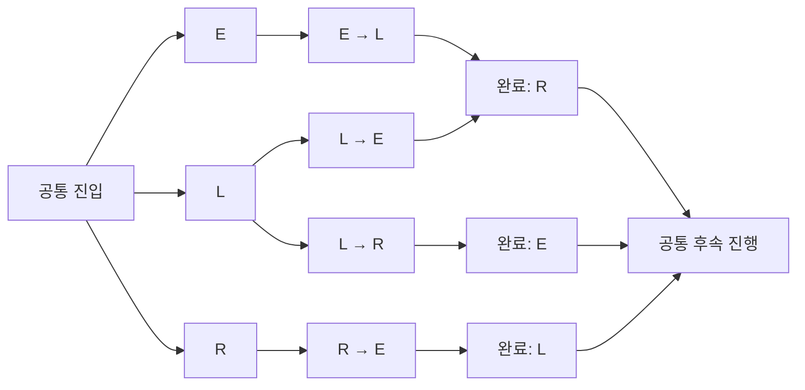

# 유한 기믹 블록과 선택 이력 생성

2026-11-02, 구현 커밋 `0e8f67a` 기준으로 raid의 공통 진행 경계 사이에서 순서가 바뀌는 기믹 블록을 학습하고 기존 `phase`·`enter from`으로 렌더링한다. 시각을 정확히 재현하기보다 현재 구간을 식별하고 뒤의 기믹을 예고하는 것이 목표다. 전투별 ID·이름·cactbot 가상 시각은 생산 코드에 사용하지 않는다.

## 구조 학습과 시간 추정

| 단계      | 처리                                                                                                                                                                                                                                                        |
| --------- | ----------------------------------------------------------------------------------------------------------------------------------------------------------------------------------------------------------------------------------------------------------- |
| 경계 후보 | 완료 입력들의 공통 고유 cast 중 선후가 일치하는 두 관측으로 구간을 잡는다. 두 경계가 실제 관측된 전멸 pull도 구간 학습에 사용한다. 짧은 pull의 미관측 구간은 반복·선택 차이로 추측하지 않는다.                                                              |
| 블록 분리 | 구간마다 한 번 나타나는 공통 활동에서 모든 trace에 유지되는 선후 관계를 연결한다. 연결 성분을 블록 후보로 삼고, 각 trace에서 블록의 활동이 끼어들지 않으며 같은 단일 진입 신호로 시작하는지 확인한다. 작은 내부 순서 차이 때문에 블록 전체를 나누지 않는다. |
| 학습 범위 | 현재는 3–6개 블록·서로 다른 관측 순서 3종 이상인 한 유한 구간을 지원한다. 기존 국소 두 선택 렌더러를 대체하는 일반 모델은 아니다. 후보가 여러 개면 가장 작은 지지 구간을 선택한다.                                                                          |
| 블록 본문 | 진입부터 다음 블록 또는 공통 후속 경계까지 기존 파동·부분 순서 정렬을 수행한다. 블록 내부의 공통 표시를 학습하며 모든 원본 cast를 강제로 출력하지 않는다.                                                                                                   |
| 선택 이력 | 관측된 블록 순서의 접두부를 상태로 만든다. 아직 진행 중인 서로 다른 이력은 합치지 않는다. 이후 선택이 없는 완료 상태만 마지막 블록이 같을 때 공유한다. 미관측 순서를 독립 선택 조합으로 추가하지 않는다.                                                    |
| 시각과 창 | 각 상태는 선택한 블록의 실제 진입을 0으로 사용한다. 진입 창은 이전 상태의 시작부터, 다른 관측 경로의 경쟁 발생·다음 미사용 블록·공통 후속 경계 전에 닫는다. 중앙값에 작은 오차 폭만 더하는 방식으로 진행을 거부하지 않는다.                                 |
| 실행      | `Ability`·영어 source·`from`·시간 창을 KDL에 담는다. 선택 후 예고에는 원본 후속 관측이나 evidence가 필요하지 않다. 새 문법이나 실시간 실행기는 추가하지 않는다.                                                                                             |
| 회귀 보호 | 기존 유한·option 표시의 모든 원본 노드가 새 출력에도 연결돼야 한다. 넘나드는 경계·기존 이후 branch·추정 실패 등으로 이 조건이 깨지면 새 모델만 보류하고 기존 출력을 유지한다.                                                                               |

진입 신호는 앞선 선택 상태와 결합해 진행 위치를 식별한다. 경쟁 발생이 없는 이른 시각을 단지 이전 평균과 멀다는 이유로 거부하지 않는다. 경쟁 창은 같은 이전 상태에 도달한 **다른 선택 경로**까지 검사한다. 예를 들어 L→R→E에서 R 신호가 빠졌다고 뒤의 E를 L→E의 둘째 선택으로 받아들이지 않도록 관측된 경쟁 시각 전에 창을 닫는다. 미관측 경로·미관측 시간 변동까지 안전성을 증명하는 규칙은 아니다.

## Varis EX의 생성 상태

[검증 입력 목록](varis-validation-inputs.csv)의 긴 6개 입력을 동일하게 사용했다. P3의 세 블록은 Electrified(E)·Loaded(L)·Reinforced(R)이며, 생성 입력에서 순서는 E-L-R, L-R-E, L-E-R, R-E-L 네 종류다.

| 항목              | 이전 → 새 결과                                                                                                                                                                |
| ----------------- | ----------------------------------------------------------------------------------------------------------------------------------------------------------------------------- |
| KDL 정의          | 79 → 165개. 세 블록 모델의 본문은 각각 13·8·6개 정의이며 상태별 KDL 복제도 총 정의 수에 포함한다. 실제 한 경로에서 이 복제들이 모두 표시되는 것은 아니다.                     |
| phase             | combat·구간 진입·선택 이력·공통 후속을 합쳐 13개. 게임의 P3를 여러 실행 구간으로 표현하며 보스 수가 늘었다는 뜻은 아니다.                                                     |
| P3 Gunshield 시작 | 원본 18개 중 표시 연결 **2 → 18개**                                                                                                                                           |
| P3 전체 cast 후보 | 공통 진입을 포함한 적격 원본 노드 273개 중 표시 연결 **18 → 168개**. 남은 105개를 105개의 누락 기믹으로 세지 않는다. ID 대안·helper·분절 패킷·중복 발생을 따로 검토해야 한다. |
| 원본과 기존 표시  | 원본 `progression` 그래프 동일. 기존 유한·option 표시의 원본 노드 연결도 유지                                                                                                 |
| 입력 순서와 ID    | 실제 6개 입력을 역순으로 넣어도 같은 KDL. 블록 내 발생 순번을 사용해 전투 전체에서 해당 능력이 몇 번째였는지 때문에 ID가 달라지지 않게 한다.                                  |

현재 KDL 문법에는 본문 참조 호출을 추가하지 않았다. 세 본문은 모델에서 한 번 학습하지만 서로 다른 미완료 이력을 같은 상태로 합치지 않으므로 KDL에 상태별 사본이 생긴다. 이력 상태는 64개로 제한하고 처리량 한계를 넘으면 기존 출력을 유지한다.

## 예측과 보류 검증

네 입력으로 별도 생성하고 `Hpfdk4naLwANX62D/6`·`AgTDW2qvQFyw69b4/57` 두 pull은 학습에서 제외했다. 두 pull의 선택 순서는 학습 자료에도 있지만 시각·원본 관측은 사용하지 않았다. 보고서 자체는 학습 자료와 겹치므로 독립 보고서 보류로 표시하지 않는다.

| 재생                       |        평가 원본 노드 | 결과                                                                                                                                            |
| -------------------------- | --------------------: | ----------------------------------------------------------------------------------------------------------------------------------------------- |
| 전체 cast를 Ability로 투영 |      6범위 × 28 = 168 | 표시 예측 없음 0, P3 진단 0, 최대 예측 차이 780ms                                                                                               |
| 진입 신호만 투영           |              동일 168 | 후속 기믹 관측 없이도 동일 예고. 예측 없음 0, P3 진단 0, 최대 780ms                                                                             |
| 보류 두 pull               |                    56 | 최대 차이 각각 780·561ms. 같은 이벤트·활동의 최근접 예고 비교이며 일대일 경로 증명은 아님                                                       |
| 별도 보고서의 같은 경로    | `DFVA3vq2ThWbaGC7/62` | L-E-R의 세 진입을 모두 처리. 일부 구간이 학습 자료보다 약 13초 짧아도 상태와 경쟁 창으로 식별. 이 추가 기록의 전체 본문 시각을 검증한 것은 아님 |
| 미학습 순서                |  `Hpfdk4naLwANX62D/5` | E-R-L 중 첫 E만 진입. 미관측 E→R 이력을 알려진 E→L로 대체하지 않음. 진단이 0이어도 전체 경로 검증 통과가 아님을 원본 대응 수로 확인             |

진입 신호만 넣은 재생은 P1의 branch 선택도 생략하므로 P3 밖에 `unresolved` 한 건이 있다. 이를 숨기거나 전투 전체 검증 통과로 세지 않는다. 공통 후속 경계는 중간 선택 관측이 부족해도 남은 상태를 닫고 공유 일정을 재개할 수 있다.

기존 대표 9개 콘텐츠·79개 입력도 재생성했다. KDL 해시와 모든 원본 그래프가 유지됐다. 상세 로컬 산출물은 `out/validation/block-history/`의 `accepted.kdl`·`accepted-fit.kdl`, `coverage.json`, `accepted-regression.json`, `replay.json`, `external-traces.json`과 재현용 Bun 스크립트에 있다. `manifest.json`에 생성기 커밋·명령·입력·출력 해시를 기록한다.

## 회귀와 남은 범위

| 검사               | 확인한 내용                                                                                                                                                          |
| ------------------ | -------------------------------------------------------------------------------------------------------------------------------------------------------------------- |
| 생성→KDL 단독 재생 | 합성 여섯 순서를 직접 생성하고 evidence를 지운 뒤, 진입 관측만으로 후속 기믹을 예고. 구간 간격 ±20% 변화, 반복 사용한 블록·누락된 중간 선택과 경쟁 발생도 검사       |
| 결정성·원본 보존   | 공유 기술의 전투 전체 발생 순번이 달라도 입력 역순 KDL 동일. 기존 표시가 사라질 모델은 보류                                                                          |
| property·snapshot  | 능력 ID·시계 크기·작은 기록 차이를 바꿔도 같은 블록 분리. 학습한 상태·전환 수와 창 정책을 snapshot으로 확인                                                          |
| 남은 학습          | 미관측 순서 일반화, 한 블록 내부의 ID 대안·선택·helper, 여러 유한 구간과 loop의 통합, 더 적은 증거에서의 구조 식별                                                   |
| 실행 한계          | 알려진 관측의 경쟁을 검사한 것이며 모든 누락 신호·새 경로의 안전성을 증명하지 않는다. FFLogs cast→Ability 투영과 실제 ACT·영어 이름의 정확성·외부 실행기는 별도 검증 |

이 보완은 Varis의 선택 이력과 상대 진행을 생성하는 첫 구현이다. 모든 원본 패킷을 재현하거나 전체 전투를 완전히 생성했다는 뜻은 아니다.
