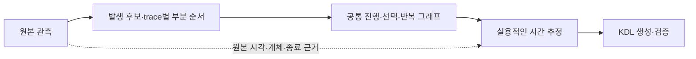

# 진행 그래프와 시간 추정의 분리 계획

2026-11-02 후속 결정: 다음 구현은 [대표 경로 기반 변경 계획](REPRESENTATIVE_PATH_PLAN.md)을 따른다. 이 문서의 원본 보존·부분 순서·구조와 시간 분리 원칙은 유지한다. 학습 출발점은 대표 로그 한 경로로 바꾸고, 아래의 기존 CLI·KDL·출력 호환 유지 방침과 이행 순서는 후속 계획으로 대체한다. 아래 구현 현황은 기존 방식의 기록이다.

이 문서는 생성기 구조의 이행 계획이다. trace별 시전 발생·부분 순서를 보존하고, 출력 후보를 그 노드에 연결해 별도 시간 추정기로 전달한다. dungeon·alliance의 제한적인 말단 반복은 원본 발생 문맥에서 먼저 학습하고 회차별 시간을 뒤에 추정한다. 나머지 공통 진행·선택 분석은 여전히 기존 기준점 기반 분석을 사용한다. 현재 동작은 [생성 계약](GENERATION.md), 구현 현황과 이행 순서는 [계획](PLAN.md)에 기록한다.

## 목표와 전제

**기믹의 진행 구조를 먼저 학습하고, 그 구조를 사용하기에 충분한 시간표로 옮긴다. 시간은 정확히 재현할 필요가 없다.** 사용자가 다음 기믹과 순서를 파악할 수 있는 실용적인 일정이 목표다. 밀리초 오차를 줄이기 위해 발생을 제거하거나 실제 선택 관계를 단순화하지 않는다.

| 원칙                  | 의미                                                                                                                                                  |
| --------------------- | ----------------------------------------------------------------------------------------------------------------------------------------------------- |
| 구조와 예정 시각 분리 | 발생의 존재·대응·순서·선택·반복을 최종 예정 시각과 별도로 보존한다. 시각을 아직 추정하지 못한 발생도 그래프에 남는다.                                 |
| 원본 시간은 계속 사용 | 패킷 중복·파동·순서 불확실성·관측 종료 판단에 원본 밀리초와 시전·개체 정보를 사용한다. 구조 학습에서 시간을 모두 버린다는 뜻이 아니다.                |
| 시간의 목표는 실용성  | 작은 시각 차이는 허용하고, 기믹 순서·회차·선택을 헷갈리지 않는 일정을 우선한다. 원본 패킷과 최종 일정의 밀리초 단위 일치를 완료 조건으로 두지 않는다. |
| 0.1초는 표현 단위     | KDL은 소수 첫째 자리 초로 출력한다. 이는 실제 전투와 100ms 이내로 일치한다는 정확도 보장이 아니다. 원본과 추정·반올림 근거는 따로 보존한다.           |
| 표시와 sync 분리      | 근사 시각으로 표시할 수 있어도 자동 sync로 사용하려면 회차·활성 범위·경쟁 신호를 구분하는 별도 근거가 필요하다.                                       |
| 콘텐츠별 예외 금지    | 특정 전투·능력 ID·고정 시각은 검증 자료로만 사용한다. 입력은 FFLogs JSON과 mode이며 수동 그래프·시간 템플릿을 요구하지 않는다.                        |

## 단계와 데이터 경계

### 시간 차이와 모호함을 다루는 기준

시간 차이가 수 초·수십 초라는 이유만으로 같은 진행 위치의 대응을 거부하지 않는다. 시간표는 그래프 위의 초기 예상 일정이며, sync는 관측으로 현재 진행 위치를 확인하고 공유 시계를 보정하는 수단이다. [cactbot 시계 조사](CACTBOT_CLOCK_RESEARCH.md)에서 다룬 시계 보정과, 분기 구간을 배치하기 위한 가상 시각 jump는 구분한다. jump의 숫자 크기를 그대로 실제 전투 시간 오차로 해석하지 않는다.

| 상황                                             | 구조와 시간의 처리                                                                                                                        |
| ------------------------------------------------ | ----------------------------------------------------------------------------------------------------------------------------------------- |
| 원본 대응은 여럿이지만 발생·회차·선택이 같음     | 원본 대응 후보를 보존하고, 실용적으로 같은 일정이면 표시용 대표값을 추정한다. 원본 패킷 대응의 유일성을 표시의 필수 조건으로 두지 않는다. |
| 같은 구간이 크게 늦거나 빨라짐                   | 진행 구조를 유지한다. 구간 기준점과 후속 관측으로 시계를 보정할 수 있는지 검사한다. 시간 차이의 크기만으로 노드를 제외하지 않는다.        |
| 확인된 후속 구간에 진입                          | 현재 진행 위치를 갱신한다. 기존 실행 계약에 따라 건너뛴 예정 이벤트를 기록하고, 미관측·실제 누락·잘못된 선택과 구분한다.                  |
| 같은 ID가 다른 회차·경로에도 존재                | 현재 구간·선택 이력·주변 신호와 경쟁 조건으로 위치를 구분한다. 넓은 시간 window나 가까운 시각만으로 임의 선택하지 않는다.                 |
| 후보에 따라 발생 수·회차·선택·실행 결과가 달라짐 | 별도 구조 후보나 미해결로 유지한다. 큰 시계 보정을 허용한다는 이유로 서로 다른 구조를 평균내지 않는다.                                    |

기존 실패에서 확인한 문제는 시간 대응과 구조 보존의 결합이다. 고유 시각 기준점이 없으면 보조 액터의 범위가 만들어지지 않았고, 경계 근접이나 묶음 차이가 구간 전체 또는 후속 발생을 제외시켰다. 다중집합 전체 일치와 선택 이력 미반영도 별도 원인이다. 이 분리가 모든 누락을 해결한다고 가정하지 않고 회귀 자료에서 각각 검증한다.

새 판정 기준은 ‘원본 대응이 유일한가’만이 아니라 ‘가능한 대응에 따라 사용·실행 결과가 달라지는가’다. 구조 적합성과 위치 식별 근거를 우선하고 시간 차이는 보조 근거로 사용한다. 큰 보정의 안전성은 보정량의 상한 하나 대신, 다른 회차·선택과의 구분 및 건너뛰기·중복 처리 의미로 검사한다.

| 단계             | 입력과 책임                                                                        | 출력                                                    | 이 단계에서 결정하지 않는 것                                            |
| ---------------- | ---------------------------------------------------------------------------------- | ------------------------------------------------------- | ----------------------------------------------------------------------- |
| 관측 정리        | 입력 검사, 패킷·개체·시전·파동 후보 대응, 확실한 선후 관계와 불확실성 추출         | 원본 인덱스에 연결된 발생 후보와 trace별 부분 순서      | 최종 예정 시각, 동시 관측이 게임상 독립이라는 판단                      |
| 진행 그래프 구성 | trace들을 대응해 공통 진행·선택 이력·반복·합류와 미해결 관계를 학습                | 발생 노드, 조건부 진행 관계, 원본 대응과 지지·반례      | 중앙값 예정 시각, sync window, 고유 시각 기준점이 없는 발생의 자동 삭제 |
| 시간 추정        | 고정된 그래프와 원본 대응을 사용해 해당 경로·시계에서 표시 시각과 변동 범위를 추정 | 그래프 노드에 연결된 상대 시각·표본·변동·추정 불가 사유 | 시간에 맞추기 위한 노드 병합·삭제, 선택·합류 관계 재작성                |
| KDL 생성         | 진행 그래프와 시간 추정을 기존 mode·실행 계약으로 변환하고 sync 조건을 별도 검사   | 단독 실행 가능한 KDL과 구조·시간·제외 근거              | evidence를 참조하는 runtime 동작, FFLogs 종료를 이용한 가짜 실행 신호   |

단계 사이 자료는 메모리 안에서 전달한다. 파일로 남기는 그래프·근거는 검토용이며 필수 CLI 입력이나 중간 파일 왕복을 추가하지 않는다. 시간 추정에서 구조 모순이 드러나면 진단과 재검토 대상으로 돌려보내며, 노드를 조용히 바꾸거나 만족할 때까지 구조를 자동 재선택하지 않는다.

## 진행 그래프의 의미

| 요소             | 보존할 내용과 제약                                                                                                                                                                                         |
| ---------------- | ---------------------------------------------------------------------------------------------------------------------------------------------------------------------------------------------------------- |
| 발생 노드        | 능력 ID 하나가 아닌 개별 발생을 나타낸다. 같은 능력의 6연타는 별도 발생 6개다. 패킷 분절인지 실제 반복인지 미확정이면 대응 후보와 그 이유를 유지한다. 노드의 존재와 원본 행의 유일한 대응은 구분한다.      |
| 노드 식별        | 사람이 읽을 수 있는 발생 ID와 원본 대응을 보존한다. 예정 시각의 재추정·반올림만으로 ID를 바꾸지 않는다. 서로 다른 구조를 추가 자료로 구별하게 되면 분리·병합 근거와 대응을 기록한다.                       |
| 선후 관계        | 관측이 지지하는 부분 순서만 연결한다. 근접 관측을 임의 순서로 직렬화하거나 무관계인 노드를 자동 병렬 실행으로 해석하지 않는다. 인접 노드 간 간격을 모두 같은 독립 지연 변수로 취급하지 않는다.             |
| 선택과 공통 진행 | 공통 노드의 표시를 공유해도 이전 선택의 영향은 보존한다. 뒤쪽 진행이 선택에 종속되면 조건부 관계나 선택 문맥을 유지한다. 중간 공통 이벤트 하나만으로 상태를 합치지 않는다.                                 |
| 반복             | 유한한 trace의 발생 부분 순서와, 여러 trace에서 학습한 반복 구조를 구분한다. 반복·탈출에 관측 근거가 있을 때만 기존 무한 반복·신호 탈출 계약으로 옮긴다.                                                   |
| 보조 액터        | 자기 고유 시각 기준점의 존재를 노드 생성의 필수 조건으로 두지 않는다. 보스·전투 문맥과 액터 근거로 대응하고, 연결을 확정하지 못하면 미해결로 남긴다. 무관한 액터·잡몹을 시간 근접도만으로 연결하지 않는다. |
| 관측 종료        | 조기 처치·중단 이후의 미관측과 관측 기간 안의 내부 누락을 구분한다. 긴 미처치 trace의 후반도 근거로 사용하되 종료 경계를 게임 신호로 만들지 않는다.                                                        |
| 대상 범위와 누락 | 분석 대상으로 선택한 모든 관측 후보는 노드·대응 후보 또는 명시적인 제외 사유에 연결한다. 모든 원본 피해 패킷을 그대로 노드로 복제하거나, 연결을 채우기 위해 가짜 간선을 추가하지 않는다.                   |

예를 들어 `Axe → 공통 구간 → Scythe`와 `Scythe → 공통 구간 → Axe`는 중간 표시를 공유할 수 있지만 선택 상태는 다르다. 첫 선택의 영향을 보존한 뒤 기존 option 본문·requires로 표현한다. 두 경로를 합친 결과가 관측하지 않은 `Axe → 공통 구간 → Axe`까지 허용하면 구조 검증 실패다. 합류 여부는 단일 후속 이벤트의 일치가 아니라 선택 문맥과 이후 진행의 근거로 판단한다.

## 실용적인 시간 추정

| 대상             | 추정 정책                                                                                                                                                                                                                                                                         |
| ---------------- | --------------------------------------------------------------------------------------------------------------------------------------------------------------------------------------------------------------------------------------------------------------------------------- |
| 시각의 기준      | 노드·경로를 기존 전투·phase·반복 회차 및 option의 상대 기준점에 연결한다. 분석 분리가 새로운 runtime 시계를 도입하지 않는다.                                                                                                                                                      |
| 대표 시각        | 경로별로 대응되는 발생의 상대 표본에서 중앙값 같은 잡음에 덜 민감한 대표값을 추정한다. 원본 개체·패킷이 많은 로그가 과도한 가중치를 갖지 않게 한다. 기존 중앙값 정책은 재사용 출발점이며 최종 비용함수로 고정하지 않는다.                                                         |
| 대응과 시간 차이 | 원본 패킷의 정확한 대응이 하나로 정해지지 않아도 발생·위치 범위가 충분히 뒷받침되면 표시용 근사 시각을 평가할 수 있다. 수 초·수십 초 차이도 크기만으로 실패 처리하지 않는다. 위치 식별 근거와 보정 결과를 검사하고 모호함을 없애기 위해 임의 대응을 확정하지 않는다.              |
| 경로별 차이      | 서로 다른 선택·회차·시계 구간의 표본을 섞어 실제로 없는 중간 시각을 만들지 않는다. 시각 분포가 갈리면 경로를 구분하거나 미해결로 보고한다. 시간 추정기가 그 이유로 그래프를 재작성하지 않는다.                                                                                    |
| 오차와 보정      | 표시에는 변동과 보정 여유를 허용한다. sync·선택 window는 실제 경쟁 신호와 실행 가능 범위를 별도로 검사한다. 넓은 window로 다른 발생에 잘못 반응하는 문제를 숨기지 않는다.                                                                                                         |
| 추정 불가        | 그래프 노드를 유지하고 시간 추정 불가를 기록한다. 0초·직전 시각·등간격으로 임의 채우지 않는다. KDL에 일정으로 옮기지 못한 노드는 이유를 분리해 보고한다.                                                                                                                          |
| 완료 판단        | 다음 기믹·선택·회차를 알아볼 수 있는 일정인지, 보정 때문에 반복 누락·중복·잘못된 선택이 생기지 않는지 평가한다. 평균 시간 오차나 이벤트 수 하나로 품질을 판정하지 않는다. 허용 오차는 검증 자료의 기믹 간격·변동과 구분 가능성에 근거해 기록하고 전투별 하드코딩으로 넣지 않는다. |

구조 학습이 최종 예정 시각에 종속되지는 않지만 원본 시간에 완전히 불변인 것도 아니다. 작은 기록 오차 때문에 이미 확인된 발생이 사라져서는 안 되며, 실제 선후 관계나 파동 경계를 바꾸는 시간 차이는 구조 근거로 반영해야 한다. 최종 0.1초 반올림 뒤의 window·범위·충돌 검사는 기존 [타임라인 스키마](TIMELINE_SCHEMA.md)를 따른다.

## 이행 순서와 완료 조건

| 순서 | 구현 단위                                                 | 완료 기준                                                                                                                                                           |
| ---- | --------------------------------------------------------- | ------------------------------------------------------------------------------------------------------------------------------------------------------------------- |
| 1    | 기존 관측·파동 정리와 원본 대응을 예정 시각 생성에서 분리 | 원본 해시·인덱스·개체·시간 및 미해결 대응을 보존하고, 새로운 수동 입력을 요구하지 않는다. 기존 분절·경계 완화 회귀를 유지한다.                                      |
| 2    | 발생 단위 진행 그래프 구성과 구조 검사                    | 반복 발생을 별도로 표현하고 고유 시각 기준점 없는 후보도 보존한다. 시간 추정을 실행하지 않고 발생·선후·선택 이력·관측 종료를 검사할 수 있다.                        |
| 3    | 기존 정렬·후반·선택·helper 분석을 그래프 구성에 연결      | 현재 생성기에서 확인된 발생과 후반 지지를 유지한다. 보수적인 미해결 관계를 가짜 분기·합류·독립성으로 채우지 않는다.                                                 |
| 4    | 그래프를 입력으로 받는 별도 시간 추정                     | 같은 그래프의 대표 시각·여유를 바꿔도 노드 ID·발생 수·조건부 관계가 유지된다. 추정 결과가 부족해도 그래프에 노드는 남는다.                                          |
| 5    | 기존 KDL 생성기를 그래프와 시간 추정 결과의 소비자로 변경 | event·branch·requires·loop·sync를 기존 계약으로 표현한다. CLI·mode·독립 KDL 실행을 유지하며 파일을 중간 입력으로 요구하지 않는다.                                   |
| 6    | 구조·시간·생성 결과의 독립 평가                           | 자동 검증용 입력을 먼저 분리하고, 학습용 관측 대응·그래프·시간 추정 어디에도 검증 입력을 누출하지 않는다. 전체 입력을 사용한 최종 모델과 임시 검증 모델을 구분한다. |

새 라이브러리나 범용 워크플로 엔진을 선행 조건으로 두지 않는다. 기존 DFG는 관측 통계로 재사용할 수 있지만, 활동별 DFG를 곧바로 발생·선택 이력이 보존된 진행 그래프로 취급하지 않는다. [기법 보완안](PROCESS_MINING_TECHNIQUES.md)의 부분 순서 정렬·선택 이력 학습은 이 단계들의 수단으로 적용한다.

### 첫 구현의 범위

dungeon·alliance는 본체의 관측된 처치·instance로 학습 뷰를 구분하고, 고유 시전이 없는 보스도 동일한 단일 진입과 후속 강제 대응으로 공통 표시를 생성한다. 원본 그래프는 실패 시도·범위 밖 helper를 포함해 보존한다. 이는 trace 간 조건부 그래프·반복 모델의 완성을 뜻하지 않는다. 상세 규칙과 검증 범위는 [생성 계약](GENERATION.md#보스-시도-범위와-고유-시전-없는-진행), [Clyteum 감사](CLYTEUM_OMISSION_AUDIT.md)에 기록한다.

trace별 저장소는 `petgraph::StableDiGraph`를 사용한다. 후보 제거가 다른 발생의 인덱스를 바꾸지 않으며, evidence의 노드별 `index`와 `before`·`observation_nodes`가 같은 내부 참조를 사용한다. `nodes` 배열의 위치를 참조로 해석하지 않는다. 내부 인덱스는 영구 ID가 아니며 KDL의 사람이 읽는 event ID와 구분한다. 원본 시각 표본은 그래프 밖에 유지하고 제거된 노드의 시각 요청은 오류로 처리한다. 시각에 따른 부분 순서 규칙은 도메인 분석으로 남기고 도달 가능성과 위상 정렬 검사는 petgraph로 수행한다.

| 경계        | 현재 동작과 한계                                                                                                                                                          |
| ----------- | ------------------------------------------------------------------------------------------------------------------------------------------------------------------------- |
| 후보 보존   | 모든 입력 trace의 시전 파동 후보를 원본 관측 인덱스·활동·회차에 연결한다. 고유 기준점이 없는 helper와 미출력 발생도 남긴다. 패킷 분절 후보는 아직 별도 노드다.            |
| 부분 순서   | 100ms보다 크게 떨어진 관측의 확실한 순서를 보존한다. `0,80,160ms`에서 이웃 순서는 미확정이어도 `0→160`은 유지한다. 무관계를 병렬성으로 해석하지 않는다.                   |
| 자원 한계   | trace당 관계 100만 개를 넘으면 나머지 관계를 생략하고 `relations_complete=false`로 보고한다. 노드는 삭제하지 않는다.                                                      |
| 출력과 시간 | 기존 분석이 선택한 발생을 노드 참조로 바인딩하고 시간 추정기가 원본 표본·원점을 받아 중앙값과 범위를 계산한다. 큰 시간 차이를 별도의 대응 거부 조건으로 쓰지 않는다.      |
| 근거        | evidence의 `progression.traces`에 노드와 선후 관계, 각 출력 이벤트의 `observation_nodes`에 원본 노드 참조를 남긴다. 내부 인덱스는 KDL의 사람이 읽는 event ID와 구분한다.  |
| 남은 분리   | trace 간 대응·조건부 진행·반복의 통합 학습과 시간 추정 실패의 부분 출력은 미구현이다. 그래프에 보존됐다는 사실만으로 KDL 복원이나 실행 품질이 개선됐다고 판정하지 않는다. |

첫 단계 검증에서는 R11S·R9S·R10S·Clyteum의 KDL이 기존 생성본과 바이트 단위로 같았다. 회귀 테스트는 반복 helper 보존, 원본 표본 참조, 시간 추정 실패 후 그래프 불변성, 부분 순서의 도달 가능성을 검사한다. 외부 실시간 실행 검증을 뜻하지 않는다.

## 필수 검증 사례

| 사례                                 | 구조 검사                             | 시간·생성 검사                                                                      |
| ------------------------------------ | ------------------------------------- | ----------------------------------------------------------------------------------- |
| 같은 능력의 6회 발생                 | 6개의 발생과 순서를 보존              | 실제 진행 관계를 바꾸지 않는 작은 jitter·대표값 변경으로 발생 수나 ID가 바뀌지 않음 |
| 확실한 발생, 유일하지 않은 원본 대응 | 발생의 지지와 가능한 원본 대응을 분리 | 근사 일정의 근거가 충분한지 평가하고 불충분하면 시간만 미해결                       |
| 시간 추정 실패                       | 발생·연결을 그래프에 보존             | 시간 미해결과 KDL 미출력 사유를 명시하며 임의 시각 생성 금지                        |
| A→공통→B / B→공통→A                  | 첫 선택의 상태와 반대 후속 발생 보존  | 선택별 일정을 유지하고 A→공통→A 같은 경로 생성 금지                                 |
| 순서가 미확정인 인접 관측            | 확실한 부분 순서만 보존               | 임의 직렬화로 sync·분기·독립성을 만들지 않음                                        |
| 자기 고유 기준점 없는 반복 helper    | 전투 문맥의 지지와 무관한 액터를 구분 | 연결이 확인된 발생에 문맥 기준 시각을 추정                                          |
| 짧은 clear와 긴 미처치 trace         | 관측 종료 뒤의 후반과 내부 누락 구분  | 지지된 마지막 발생을 유지하고 짧은 기록에 미래 관측을 요구하지 않음                 |
| 구조만 같은 시간 변형                | 그래프·ID·선택 의존성 유지            | 충분히 사용할 수 있는 일정·여유로 조정 가능                                         |
| 일부 경로만 관측                     | 실제 지지된 구조와 미해결 후보 구분   | 모든 분기 조합이나 다른 경로의 시간표를 추정해 채우지 않음                          |

합성 ID·시각·인스턴스 변형, R11S와 다른 raid/dungeon 입력을 함께 사용한다. ID 존재 검사와 생성본 재생 성공만으로 누락 없는 그래프를 보장하지 않는다. 구조 적합성, 표시 일정의 실용성, sync 안전성, KDL 실행 의미를 따로 보고한다. FFLogs 기반 분석과 합성 재생은 ACT·외부 실행기의 실제 동등성을 검증하지 않는다.
