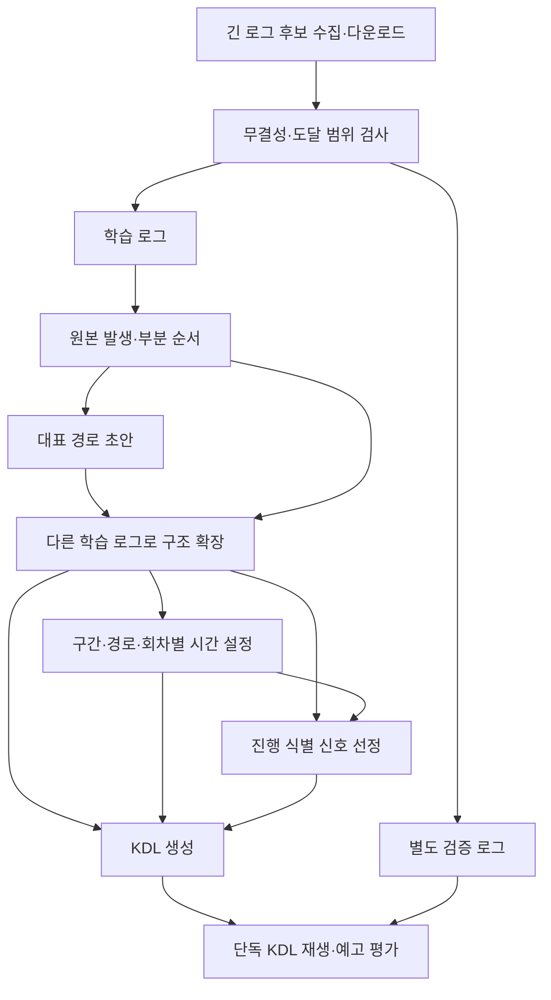

# 대표 경로 기반 타임라인 생성 변경 계획

2026-11-02 작성. 이 문서는 구현 계획이다. 현재 동작은 [생성 계약](GENERATION.md), [수집 계약](FFLOGS_COLLECTION.md), [오프라인 재생 안내](OFFLINE_REPLAY.md)에 따른다. 아래 변경을 구현할 때 해당 계약과 테스트를 함께 갱신한다. 기존 [구조·시간 분리 계획](PROGRESSION_AND_TIMING.md)의 원본 보존·부분 순서·시간 분리 원칙은 유지하고, 학습 출발점과 이행 순서·호환성 방침은 이 문서로 대체한다.

## 결정과 목표

**전멸기까지 진행된 양질의 로그에서 대표 경로 초안을 만들고, 다른 로그로 분기·반복·합류를 완성한다. 진행 그래프에 시간표와 동기화 조건을 별도로 설정한다.**

| 결정      | 적용 방식                                                                                                                     |
| --------- | ----------------------------------------------------------------------------------------------------------------------------- |
| 학습 자료 | 전멸기까지 도달한 온전한 로그를 우선한다. 전멸기가 없는 콘텐츠는 마지막 고유 구간과 충분한 반복이 관측된 시도를 사용한다.     |
| 초안      | 대표 로그의 실제 한 경로를 보존한다. 여러 로그에 공통으로 있다는 것을 발생의 존재 조건으로 요구하지 않는다.                   |
| 구조 확장 | 다른 로그와의 차이를 대안·반복·합류·탈출 또는 미해결로 설명한다. 대표 경로도 반례에 따라 수정한다.                            |
| 시간 분리 | 발생·선후·선택 이력·회차를 먼저 구성한다. 예정 시각·반복 주기·window는 이후에 설정한다. 원본 시간은 구조 판단에도 사용한다.   |
| 빠른 진행 | 같은 후속 진행에 일찍 도달하면 주요 스킬의 넓은 sync window로 보정한다. 내용·순서가 달라지면 구조로 표현한다.                 |
| 호환성    | 기존 생성 결과·evidence·수집 계획·CLI 및 필요하면 KDL 계약도 변경한다. 이전 출력과의 바이트 일치를 완료 조건으로 삼지 않는다. |
| 실행      | 최종 KDL 하나로 외부 실행이 가능해야 한다. evidence·FFLogs 메타데이터를 runtime 조건으로 사용하지 않는다.                     |

게임 전투가 설계된 진행이라는 전제를 활용하되 모든 콘텐츠가 고정 시간표라는 전제는 두지 않는다. 선택 이력, HP 전환, 적 처치 대기, 첫 회차 전용 동작을 보존한다. 대상·위치 차이가 후속 진행을 바꾸지 않으면 타임라인 분기를 만들지 않는다.

## 현재 구현과 교체 범위

| 현재 위치                                              | 확인한 역할                                                      | 변경 방향                                                                                                       |
| ------------------------------------------------------ | ---------------------------------------------------------------- | --------------------------------------------------------------------------------------------------------------- |
| `src/fflogs/collection/selection.rs`                   | 보고서·전투군·처치/전멸 균형과 긴/짧은 기록 교대 선택            | 긴 학습 후보 우선으로 교체. 짧은 검증 기록은 별도 확보한다.                                                     |
| `src/fflogs/collection.rs`, `model.rs`, `storage.rs`   | 후보 조회, 메타데이터 보존, 예산, 다운로드 검증·재개             | I/O·무결성 검사는 재사용. 수집 목적·선택 근거와 도달 범위 분류를 연결한다.                                      |
| `src/generate/input.rs`, `pairing.rs`, `mining.rs`     | 입력 검사, 시전 짝짓기, 원본 batch·actor·시도 범위 구성          | 원본 정규화를 재사용. 품질・입력 역할 판정과 실행 그래프 입력을 구성한다.                                       |
| `src/generate/mining/progression.rs`                   | trace별 발생·부분 순서와 원본 시각 참조. 통합 실행 그래프는 아님 | 원본 발생 저장을 유지하고 대표 경로에서 확장하는 실행 그래프를 구성한다. 기존 petgraph를 사용한다.              |
| `mining/common.rs`, `alignment.rs`, `occurrences/*.rs` | 공통 기준점·구간 정렬과 별도 분기·이력·말단 loop·helper 학습     | 대응·문맥 판단은 재사용하되 공통 부분만 출력하는 정책을 제거한다. 구조 학습 결과를 하나의 실행 그래프에 모은다. |
| `src/generate/timing.rs`                               | 대응된 발생의 상대 시각 중앙값·범위 추정                         | 그래프 노드·구간·회차에서 시간표를 산출하는 경계를 완성한다.                                                    |
| `src/generate/render.rs`, `render/*.rs`                | anchors·loop·history를 조합하면서 시간 설정과 KDL 생성           | 구조 학습을 제거하고 실행 그래프·시간표·신호 계획의 소비자로 변경한다.                                          |
| `src/timeline/{parse,replay,fflogs}.rs`                | KDL 검사, 공유 시계·분기·loop 실행, FFLogs 투영                  | 우선 재사용. 최소 반례로 표현 한계가 확인되면 계약과 구현을 함께 수정한다.                                      |
| `src/cli.rs`, `tests/`, `scripts/*.ts`                 | 명령, evidence 검사, 참조 비교·예측 검사                         | 입력 역할과 새 evidence를 연결하고 구조·예고·보정 결과를 검사한다.                                              |

`mine`의 DFG는 관측 통계로 유지할 수 있지만 실행 그래프의 정답으로 사용하지 않는다. 새 의존성·범용 워크플로 엔진·수동 중간 파일은 추가하지 않는다.

## 처리 흐름과 자료 경계

| 자료        | 포함하는 내용                                                                  | 경계                                                                    |
| ----------- | ------------------------------------------------------------------------------ | ----------------------------------------------------------------------- |
| 원본 관측   | 해시, report/fight, 원본 인덱스·밀리초·actor/instance, 파동·시도 범위          | 학습 선택에서 빠져도 삭제하지 않는다.                                   |
| 실행 그래프 | 발생 ID, 원본 대응, 기믹 구간, 선택·이력, 반복·회차 대응, 합류·탈출, 지지·반례 | 예정 시각·window 없이 구성·검사할 수 있다. 활동 ID별 그래프와 구분한다. |
| 시간표      | 그래프 ID별 원점·예정 시각, loop 주기, 표본·변동·추정 실패                     | 그래프를 불변 입력으로 받는다. 시각 조정으로 구조·ID를 변경하지 않는다. |
| 신호 계획   | start/enter/선택/merge/until/sync의 신호·목적지·활성 범위·window·경쟁 판정     | 모든 표시 발생에 sync를 붙이지 않는다.                                  |
| 검증 결과   | 경로·관측 대응·예고 시점·보정・누락・모호함・미검사 범위                       | 검증 입력은 대표 선택·구조·시간·window 학습에 사용하지 않는다.          |

자료는 메모리에서 전달한다. evidence에는 검토용 그래프와 근거를 저장하지만 생성·실행을 위해 다시 읽는 단계를 만들지 않는다.

## 1. 수집·품질·입력 역할

| 작업               | 계획·판정 규칙                                                                                                                                                                                                                   |
| ------------------ | -------------------------------------------------------------------------------------------------------------------------------------------------------------------------------------------------------------------------------- |
| 후보 탐색          | encounter·난이도·game zone과 버전·Echo 등 조건을 확인한다. 미완료 업로드·접근 불가 보고서는 제외한다. 비교 불가능한 조건은 별도 군으로 분리하거나 이유를 보고한다.                                                               |
| 다운로드 우선순위  | 학습용 처치/전멸 균형과 긴/짧은 교대를 제거한다. 같은 전투군에서는 긴 진행 후보를 우선하고 비교 가능한 후보 사이에 보고서 다양성을 확보한다.                                                                                     |
| 사전·사후 구분     | 길이·phase·진행 메타데이터는 후보 선택에 사용한다. 다운로드 후 실제 관측으로 무결성·후반 도달·보스 시도 범위를 검사한다. 긴 기록·낮은 HP·kill=false만으로 전멸기 도달을 확정하지 않는다.                                         |
| 전멸기 근거        | 첫 코퍼스에서 전멸기 관측을 감사하고 수집 가능한 종료·진행 신호와 반복 후 종료 문맥으로 자동 판정 가능한 범위를 확인한다. 전투별 능력 ID 목록이나 cactbot 파일은 생성기에 넣지 않는다. 근거가 부족하면 도달 미확인으로 보고한다. |
| 자료 부족          | 예산 안에서 긴 후보를 추가 다운로드한다. 예산 소진·후반 미확인은 부족으로 보고한다. 부족한 로그에서도 초안은 만들 수 있지만 완전한 경로로 표시하지 않는다.                                                                       |
| 전멸기 없는 콘텐츠 | 보스별 마지막 고유 구간·완료된 반복 회차·후속 관측으로 범위를 평가한다. 던전 전체 길이를 개별 보스의 반복 근거로 사용하지 않는다.                                                                                                |

다운로드 재개·원본 비덮어쓰기·요청/포인트/바이트 예산은 유지한다. 기존 원본 로그도 재검사해 사용할 수 있다. 단일 충분 로그의 한 경로 초안을 허용하되 미관측 대안·반복의 일반화는 주장하지 않는다.

학습/검증 역할은 생성 시작 전에 고정한다. `generate INPUT... --mode MODE --verify CHECK... -o OUTPUT`으로 검증 전용 입력을 명시한다. 검증 인자가 없으면 학습 재현만 보고하고 독립 검증은 미실시로 표시한다. 보고서 보류 검사는 매번 품질 선별·대표 선택부터 다시 수행한다. 중복 업로드는 가능한 범위에서 탐지·묶고 중복 의심을 보고한다.

## 2. 대표 경로 초안

| 항목           | 계획                                                                                                                                                                |
| -------------- | ------------------------------------------------------------------------------------------------------------------------------------------------------------------- |
| 선택 단위      | raid는 한 전투 경로, dungeon·alliance는 보스 시도별 경로. 이동 시간으로 보스 일정을 연결하지 않는다.                                                                |
| 선택 순서      | 무결성 통과 → 확인된 후반 범위 → 해결 가능한 발생·시도 범위 → 충분한 반복 관측 순으로 비교한다. 동률은 report/fight로 결정한다. 최장 로그를 무조건 선택하지 않는다. |
| 초안 구성      | 실행 대상 발생을 개별 노드로 보존하고 확실한 선후 관계를 연결한다. 근접 동시 관측은 부분 순서로 남긴다.                                                             |
| 단일 로그 지지 | 한 로그에서 온 발생도 초안에 둔다. 다른 로그에 없으면 종료·누락·대안을 조사하고 지지 수준을 기록한다.                                                               |
| 보조 액터      | 본체·전투·기믹 문맥에 귀속 가능한 표시 후보를 연결한다. 미확정 관측은 원본 후보로 유지하고 sync로 자동 승격하지 않는다.                                             |
| ID             | 시간과 독립된 사람이 읽는 ID를 사용한다. 입력 순서 변경으로 결과가 바뀌지 않아야 한다. 실제 구조 변경에 따른 ID 변경과 대응은 보고한다.                             |

모든 로그 쌍의 거리 계산·최적 대표 탐색은 선행 조건으로 요구하지 않는다. 결정적인 비교로 시작하고 잘못 선택된 대표도 구조 확장에서 수정한다.

## 3. 다중 로그 구조 확장

원본 발생·부분 순서 정리를 재사용해 대표 경로에 다른 학습 로그를 결정적인 순서로 대응한다. 고유 공통 신호는 유용한 기준이지만 그 부재로 구간을 통째로 버리지 않는다. 기믹 블록은 주변 본체 신호·반복 문맥·액터·선택 이력으로 묶는다. 같은 이름·ID의 재등장만으로 동일 블록을 확정하지 않는다.

| 대표와 다른 관측           | 처리 예                                                                                                     |
| -------------------------- | ----------------------------------------------------------------------------------------------------------- |
| `A B C D` / `A C B D`      | B·C가 구별되는 블록이면 순서 대안과 D 합류를 구성한다. 근접 기록 순서 차이면 부분 순서로 보존한다.          |
| `A B C D` / `A B D`        | C의 생략·기록 누락·조기 진행을 구분한다. 부재만으로 분기를 만들지 않는다.                                   |
| `A B C D` / `A B C B C D`  | B·C 반복 후보와 회차 대응·변형·탈출 신호를 검사한다. 두 번 보였다는 사실만으로 무한 반복을 확정하지 않는다. |
| `A X D Y` / `A Y D X`      | D 표시를 공유해도 X/Y 이력을 유지한다. `A X D X`를 새 경로로 만들지 않는다.                                 |
| 같은 후속 구간의 조기 진입 | 순서가 유지되면 시간·동기화로 보완한다. 생략 구간은 후속 신호로 닫히는 경계·탈출도 표현한다.                |
| 다른 로그가 중간 종료      | 종료 뒤는 미관측이다. 대표 후반을 삭제하거나 별도 선택지로 만들지 않는다.                                   |

각 관측은 실행 노드·대응 후보·제외 사유로 추적한다. 구조 변경 시 지지·반례·원본 대응을 함께 갱신한다. 자원 제한으로 중단한 구간은 미완료로 보고한다.

기존의 raid 한 국소 branch, loop가 있으면 history 미생성, 고유 경계 안 3–6개 블록·64개 이력 같은 정책 제한은 제거한다. 실제 계산량 한계와 미해결 구조는 명시한다. 관측한 조각을 근거 없이 모든 가능한 경로로 조합하지 않는다.

## 4. 시간표·동기화 설정

| 항목        | 계획                                                                                                                                                                               |
| ----------- | ---------------------------------------------------------------------------------------------------------------------------------------------------------------------------------- |
| 초기 시간표 | 대표 로그의 시각을 출발점으로 쓴다. 경로·회차·원점 대응이 확인되면 상대 표본의 중앙값 등 기존 추정기를 사용한다.                                                                   |
| 구간 원점   | 전투·phase·선택·반복 진입·합류·탈출 기준으로 후속 일정을 설정한다. 다르게 진행되는 경로의 시각을 평균내지 않는다.                                                                  |
| 반복        | 첫 회차 전용 동작과 본문을 구분한다. 주기·회차 내부 시각은 구조 학습 뒤 추정하고 회차 sync로 보정한다.                                                                             |
| 표시·실패   | 실용적으로 같은 결과면 원본 대응의 모호함을 보존하고 근사 일정을 허용한다. 추정 불가 노드는 유지하고 KDL 미출력·의존 구간의 예고 제한을 보고한다. 임의 0초·등간격은 채우지 않는다. |
| 주요 신호   | 활성 구간·이력·주변 신호로 위치를 식별할 수 있는 스킬을 선택한다. 같은 ID의 다른 발생과 경쟁하는지 검사한다.                                                                       |
| 넓은 window | 구간 진입부터 후속 신호까지 가능한 조기 진행·지연 범위를 사용하고 앞/뒤 폭을 독립 설정한다. 학습 표본의 최소·최대만으로 허용 범위를 고정하지 않는다.                               |
| 스킵        | 후속 신호에서 생략 구간을 건너뛰거나 닫고 후속 일정을 보정한다. 선택·loop 재개나 지나간 이벤트 중복 실행을 금지한다.                                                               |
| 예고 한계   | 후속 신호 전의 조기 종료는 미리 알 수 없을 수 있다. 보정 이후 예고와 보정 직전 표시 지연을 구분해 평가한다.                                                                        |

예정 100초의 C가 70초에 관측되면, 활성 구간에서 유일한 C의 넓은 window로 100초 위치에 동기화하고 후속 일정을 앞당긴다. 활성 loop 탈출이 필요하면 단순 phase sync로 대체하지 않고 전환·until 의미를 사용한다. 0.1초 반올림 뒤 범위·window 충돌을 다시 검사한다.

짧은 클리어·조기 종료 로그는 주로 별도 검증에 사용한다. 그 로그에서만 드러난 새 구조를 학습에 편입하면 다른 검증 자료를 확보한다. 검증 결과를 보고 window를 조정한 뒤 같은 로그를 계속 독립 검증으로 세지 않는다.

## 5. 계약 변경·제거

| 계약      | 계획한 변경                                                                                                                      | 전환                                                                                                                       |
| --------- | -------------------------------------------------------------------------------------------------------------------------------- | -------------------------------------------------------------------------------------------------------------------------- |
| 수집 계획 | `schemaVersion=3`, 긴 진행 우선 정책, 수집 목적·선택 근거. collect에 `--purpose verification`을 추가하고 기본은 학습으로 둔다.   | v2 계획은 기존 상태와 섞지 않고 새 계획을 생성한다. 기존 원본은 보존한다.                                                  |
| 도달 범위 | 메타데이터 후보와 관측 기반 확인·미확인 구분                                                                                     | 사후 분석은 별도 상태/evidence에 남기며 원본 JSON을 수정하지 않는다.                                                       |
| 생성 입력 | 단일 로그 초안 허용, 검증 전용 `--verify`                                                                                        | JSON+mode는 재사용. CLI 도움말·오류·보고서 보류 검사를 함께 갱신한다.                                                      |
| evidence  | `version=3`. 입력 역할·품질·대표 선택, 원본 발생, 실행 그래프, 시간표, 신호 계획, 검증·미해결 분리                               | v2 소비 스크립트·snapshot을 교체한다. 호환 어댑터는 만들지 않는다.                                                         |
| KDL       | 기존 phase·branch·requires·merge·loop·until을 먼저 사용한다. 상관 선택·여러 구간·탈출 조합의 최소 사례로 표현 가능성을 검사한다. | 불가능하면 반례와 최소 구문·실행 규칙을 정하고 루트 버전·파서·검증·재생·예제를 함께 변경한다. 구조 삭제로 회피하지 않는다. |
| 품질 판정 | 구조 보존·경로 적합성·예고 실용성·sync 안전성·입력 범위를 따로 보고                                                              | 명령 성공·정렬 완료·정의 수를 전체 통과로 해석하는 소비 코드를 교체한다.                                                   |

구현 단계마다 `GENERATION.md`, `FFLOGS_COLLECTION.md`, `TIMELINE_SCHEMA.md`, `OFFLINE_REPLAY.md`, `FFLOGS_REPLAY_VERIFICATION.md`, `PLAN.md`, README와 관련 검증 문서를 갱신한다. 과거 검증은 당시 결과로 남기고 새 결과와 구분한다.

새 경로가 필요한 사례를 통과하면 anchors 중심 생성과 별도 loop/history 사후 패치 경로를 삭제한다. 원본 처리·대응에 필요한 함수는 재사용한다. 장기 이중 생성기·이전 출력 fallback은 두지 않는다.

## 구현 순서·완료 조건

현재 구현: 수집 계획 v3와 학습/검증 목적, 긴 진행 우선 후보 선택에 이어 대표 경로 그래프·단일 로그 KDL 초안·같은 발생 순서의 다중 로그 대응을 구현했다. evidence v3의 `draft`에 시간표 없는 경로·원본 참조·공통 선후 관계를 기록한다. 두 개 이상의 클리어를 사용하는 KDL은 아직 기존 분석을 사용한다. 단계 1의 도달 범위 판정·코퍼스 확보와 분기·검열·반복을 포함한 그래프 확장은 남아 있다.

| 단계 | 작업                        | 완료 조건                                                                                                                          |
| ---- | --------------------------- | ---------------------------------------------------------------------------------------------------------------------------------- |
| 0    | 기준 코퍼스·계약 사례 고정  | 기존 입력의 품질·후반 범위·누락·잘못된 경로 기록. 학습/검증 분리와 최소 구조의 KDL 표현 검사                                       |
| 1    | 긴 진행 우선 수집·사후 분류 | 계획 v3·목적 분리·재개·예산·확인/미확인 구현. 실제 전멸기 확인 로그 확보와 부족 범위 보고                                          |
| 2    | 대표 경로 실행 그래프       | 단일 로그에서 시간 설정 없이 발생·부분 순서·원본 대응 보존. 입력 순서와 무관한 대표·ID                                             |
| 3    | 분기·이력·합류              | R11S 순서 교환과 Varis 상관 선택을 같은 모델로 표현. 대표 밖 경로 추가와 미관측 조합 방지                                          |
| 4    | 반복·탈출·helper 통합       | 기존 dungeon loop, Antivirus X의 ID 대안·helper, 일반 토벌전 후반 반복 학습. 여러 구간의 선택·반복 공존. 표본 부족은 미완료로 보고 |
| 5    | 시간·신호 계획·KDL 생성     | 구조 불변 시간 설정, 넓은 window, 조기 진행·탈출·후속 보정. 기존 분석 경로 없이 독립 KDL 생성·재생                                 |
| 6    | 독립 검증·기존 경로 제거    | 장시간 학습·짧은 검증·보고서 보류·미래 예고 확인. 계약·CLI·스크립트·snapshot 갱신과 대체 코드 삭제                                 |

단계 2부터 작은 경로를 KDL까지 연결해 확인하고 단계 3–4에서 확장과 출력을 함께 발전시킨다. 구조 학습을 전부 마칠 때까지 출력 검증을 미루지 않는다. 작은 검토 가능한 변경으로 나누되 이전 출력 보존을 위해 새 모델을 왜곡하지 않는다.

## 검증 계획

| 검증        | 필수 사례·결과                                                                                                       |
| ----------- | -------------------------------------------------------------------------------------------------------------------- |
| 수집        | 긴 전멸 후보 우선, 보고서 다양성, 일반 전멸의 도달 미확인, 보스별 범위, 예산 소진·재개·stale metadata 거부           |
| 구조        | 같은 능력 6회, 고유 기준점 없는 구간, helper·분절 파동·부분 순서, 단일 로그 지지, 시간 추정 실패에도 노드 유지       |
| 일반화      | 대표 밖 대안, 순서·생략·누락 구분, 상관 선택, 여러 분기·loop 공존, 입력 순서 불변성                                  |
| 시간 분리   | 시간표를 바꿔도 구조·ID 불변. 경로·회차 표본 혼합과 큰 시간 차이만으로 구조 삭제 금지                                |
| 넓은 window | 조기 진행·지연·반올림 경계, 같은 ID의 다른 회차·활성 목적지 경쟁, 중복·재선택·종료 loop 부활 방지                    |
| 미래 예고   | 신호를 단계적으로 공급해 다음 기믹·미관측 다음 회차를 사전 표시. 관측 뒤 정답을 출력하는 것으로 통과시키지 않음      |
| 독립 평가   | 별도 보고서 장시간 경로, 빠른 처치·기믹 스킵·중도 전멸. 대표·구조·시간·window 학습으로 검증 입력 누출 금지           |
| 실제 자료   | R11S·Varis·Clyteum·기존 dungeon loop 회귀. Antivirus X·Doomtrain·Enuo의 미완료 구조 검증. 자료 부족과 구현 실패 구분 |

입력 해시·역할·도달 범위·명령·예고 평가 기준·실패를 기록한다. 원본 패킷 수를 기믹 수·표시 수와 같게 만들지는 않는다. 대상 발생은 노드·후보·제외 사유로 추적하며 설명하지 못한 관측·경로·신호는 따로 보고한다.

구현 시 관련 Rust·Bun 테스트를 먼저 실행하고 마지막에 `cargo test`, `cargo clippy --all-targets`, `bun run --cwd scripts test`로 통합 확인한다. 실제 코퍼스 재생·cactbot 참조 비교는 별도 수행한다. cactbot은 검증 참고 자료이며 생성 입력이나 전투별 하드코딩으로 사용하지 않는다.

## 완료 범위·한계

완료는 대표 초안·구조 확장·시간 설정·신호 계획이 분리되고 하나의 KDL 생성 흐름으로 연결된 상태다. 지원 범위에서 분기·이력·반복·탈출을 함께 생성하고 다른 전투에서도 검증한다. 그래프 저장이나 이벤트 수 증가만으로 완료 처리하지 않는다.

| 범위             | 처리                                                                                                      |
| ---------------- | --------------------------------------------------------------------------------------------------------- |
| 미관측 경로      | 정답을 만들어 채우지 않는다. 지원 경로와 부족한 대안을 보고한다.                                          |
| 전멸기 자동 판정 | FFLogs만으로 확인 불가능하면 미확인으로 남긴다. 후보 확보·초안 생성 전체를 막지는 않는다.                 |
| 조기 보스 처치   | 전투가 끝나면 후속 스킬 sync가 없다. 실제 finish/boss-complete 신호와 FFLogs 재생의 관측 한계를 구분한다. |
| 실제 실행        | FFLogs 투영·합성 재생은 ACT 신호 동등성이나 외부 실행기·게임 호환성을 증명하지 않는다.                    |
| 제외 작업        | 실시간 실행기, 번역 체계 재설계, 새 범용 엔진, 과거 evidence 호환 계층, 전투별 규칙 파일                  |
